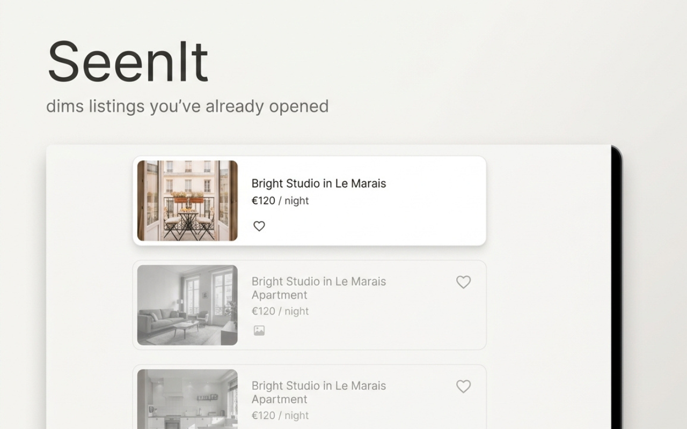

# SeenIt

Chrome extension that dims listings you've already opened on **Airbnb**, **Yad2** and **Booking.com**, so search
results stop repeating themselves.

**[Install from the Chrome Web Store](https://chromewebstore.google.com/detail/seenit/nmfodihnijiodclibgmjimhmpoikfpge)**

## What it does

- Greys out and fades listings you've already opened
- Works across tabs: open a listing in a new tab and the results page updates without a reload
- A "not interested" mark that fades a listing further, or hides it from the grid entirely
- Adjustable fade, a pause switch, and auto-forget after 1, 12 or 24 hours
- Undo per card, per results page, or everything at once

## Privacy

Everything stays on your device: no account, no backend, no analytics, no network requests.
Details are in the [privacy policy](PRIVACY.md).

The extension's source code is private. This repository holds its homepage, privacy policy and support.

## Support

Something broken, a site stopped working, or a feature request?
[Open an issue](https://github.com/NadavM-ux/seenit-public/issues) and include:

- the site (Airbnb, Yad2 or Booking.com) and the page URL if you can
- what you expected and what happened
- your Chrome version and OS
